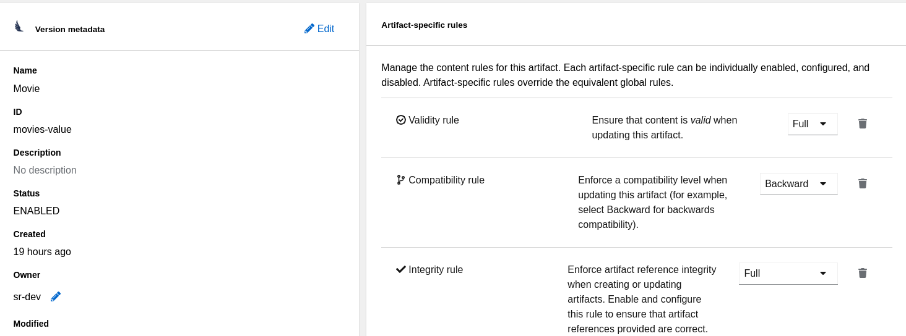

= Apicurio Registry 3

Red Hat build of Apicurio Registry 3 is a central data store for schemas and API artifacts. It is a datastore for standard event schemas and API designs. Developers can use it to decouple the data structure from their applications and share and manage the data structure using a REST interface.

It's based on Apicurio Registry open source community project.

== Prerequisites

This document expects:

* AMQ Streams operator deployed
* A Kafka cluster already deployed in your environment called `my-cluster`.
* The initial installation instructions assume that Kafka has no client authentication or authorization configured. A secured SCRAM setup is covered later.
* Keycloak installed in the keycloak namespace
* Keycloak clients: kafka-producer 

== Install 

=== Install the Operator

In the left navigation menu, click *Operators* and then *OperatorHub*.
In the `Filter by keyword` text box, enter `registry` to find the *Red Hat build of Apicurio Registry*.

Install the operator to watch all namespaces, or include the `apicurio` namespace in its watched namespaces.

=== Deploy the Registry

The following commands create an `ApicurioRegistry3` resource with KafkaSQL storage and configure separate HTTPS routes for the Registry API and UI:

* Extract the Kafka bootstrap address
* Create a Registry 3 instance
* Configure API and UI routes managed by the Registry Operator

Set environment variables for bash:

[source,shell]
----
export KAFKA_NAMESPACE=$(oc project -q)
export APICURIO_NAMESPACE=apicurio
export KAFKA_ROUTE=$(oc -n "$KAFKA_NAMESPACE" get kafka my-cluster -o jsonpath='{.status.listeners[?(@.name=="plain")].bootstrapServers}')
export PROJECT_DOMAIN=${APICURIO_NAMESPACE}.$(oc get ingresses.config/cluster -o jsonpath={.spec.domain})
----

Set environment variables for fish:

[source,shell]
----
set -x KAFKA_NAMESPACE (oc project -q)
set -x APICURIO_NAMESPACE apicurio
set -x KAFKA_ROUTE (oc -n $KAFKA_NAMESPACE get kafka my-cluster -o jsonpath='{.status.listeners[?(@.name=="plain")].bootstrapServers}')
set -x PROJECT_DOMAIN "$APICURIO_NAMESPACE."(oc get ingresses.config/cluster -o jsonpath={.spec.domain})
----

[source,shell]
----
oc get namespace "$APICURIO_NAMESPACE" >/dev/null 2>&1 || oc new-project "$APICURIO_NAMESPACE"
cat k8s/registry/01-registry.yaml | envsubst | oc apply -f -
----

Open the Registry UI at `https://registry-ui-${PROJECT_DOMAIN}`. The REST API is available at `https://registry-api-${PROJECT_DOMAIN}/apis/registry/v3`.

=== Use KafkaSQL storage with SCRAM authentication and simple authorization

This section configures the Registry's Kafka storage connection. It is independent of the Keycloak settings used to protect the Registry REST API and web console.

Prerequisites:

* Kafka listeners use `scram-sha-512` authentication and the Kafka cluster uses `simple` authorization. See xref:access.adoc#_authorization[Authorization].
* The Registry is deployed in the `apicurio` namespace and Kafka runs in `$KAFKA_NAMESPACE`.
* The Kafka `tls` listener is enabled. The Registry uses this listener so that SCRAM credentials are protected in transit.

The Registry KafkaSQL backend stores its data in the `kafkasql-journal` and `kafkasql-snapshots` topics, and uses `registry-events` for Registry events. Registry 3 requires all three topics to use `cleanup.policy: delete` with infinite retention. Create the topics and a dedicated SCRAM user:

[source,shell]
----
oc -n "$KAFKA_NAMESPACE" apply -f k8s/registry/03-kafkasql-scram-resources.yaml
oc -n "$KAFKA_NAMESPACE" wait kafkauser/apicurio-registry --for=condition=Ready --timeout=120s
----

The user is allowed to read and write both Registry topics and to use the Registry consumer groups with the `apicurio-` prefix. The User Operator creates the `apicurio-registry` Secret containing the SCRAM password; the Cluster Operator creates the `my-cluster-cluster-ca-cert` Secret containing the TLS truststore. Secrets are namespace-scoped, so copy both into `apicurio` before deploying the Registry:

[source,shell]
----
for secret in apicurio-registry my-cluster-cluster-ca-cert; do
  oc -n "$KAFKA_NAMESPACE" get secret "$secret" -o json |
    jq 'del(.metadata.namespace, .metadata.resourceVersion, .metadata.uid, .metadata.creationTimestamp, .metadata.generation, .metadata.managedFields, .metadata.ownerReferences, .metadata.annotations)' |
    oc -n "$APICURIO_NAMESPACE" apply -f -
done
----

The copy command requires `jq` and preserves the secret data while removing metadata that belongs to the source namespace.

Get the TLS bootstrap address and patch the `ApicurioRegistry3` resource:

[source,shell]
----
export KAFKA_SCRAM_BOOTSTRAP_SERVERS="$(oc -n "$KAFKA_NAMESPACE" get kafka my-cluster -o jsonpath='{.status.listeners[?(@.name=="tls")].bootstrapServers}')"
oc -n "$APICURIO_NAMESPACE" patch apicurioregistry3/registry --type=merge --patch "$(envsubst < k8s/registry/04-kafkasql-scram.yaml)"
oc -n "$APICURIO_NAMESPACE" rollout status deployment/registry-app-deployment
----

The patch configures a startup probe so that the Registry has time to initialize before liveness checks begin, the KafkaSQL TLS truststore, and the `APICURIO_KAFKA_COMMON_*` SCRAM client properties. Registry 3 supports structured configuration for OAuth only; SCRAM uses these environment variables. Do not use the plain listener for SCRAM; use a TLS listener such as `tls` (normally port `9093`).

=== Enable Registry security

NOTE: The following instructions assume that Keycloak has been installed in accordance with the other directions in this repository.

In order to enable the authorization and the following definitions can be used to import in Keycloak the clients and roles expected by the Service Registry: link:../docs/sso-registry.json[]

This will create 3 roles (sr-developer, sr-admin, sr-readonly) and 2 clients (registry-client-api, registry-client-ui).

Using the keycloak console create 2 users: `sr-dev` and `sr-admin` and assign the corresponding roles.

The following command update the previous registry deployment to enable the authentication through Keycloak:

Bash

[source,shell]
----
export KEYCLOAK_ROUTE=$(oc get route keycloak -n keycloak -o jsonpath='{.spec.host}')
oc -n "$APICURIO_NAMESPACE" patch apicurioregistry3/registry --type=merge --patch "$(envsubst < k8s/registry/02-security.yaml)"
----

Fish:

[source,shell]
----
set -x KEYCLOAK_ROUTE (oc get route keycloak -n keycloak -o jsonpath='{.spec.host}')
cat k8s/registry/02-security.yaml | envsubst | oc -n $APICURIO_NAMESPACE patch apicurioregistry3/registry --type=merge --patch-file=/dev/stdin
----

== Register a schema

Open the Registry 3 web console at `https://registry-ui-${PROJECT_DOMAIN}`.

Upload the Avro schema available here:

link:../kafka-registry/src/main/avro/movie.avsc[Movie Avro schema]

Register the schema the following values:

* Group: `quarkus`
* ID: `movies-value`

IMPORTANT: The ID is then used by the client application to retrieve and validate the schema. 
The convention for the schema ID is `<topic name>-value`. 

== Kafka Registry application

`kafka-registry` is a simple Quarkus application that reads and writes messages in a Kafka topic called `movies`.

The application is configured to validate the message schema against Apicurio Registry.

See registry section in link:../kafka-registry/src/main/resources/application.properties[application.properties]

=== Prerequisites

To run it locally it requires access to: Kafka, Registry and Keycloak.

For sake of simplicity, Kafka is supposed to be exposed with a simple TLS listener:

[source,yaml]
----
spec:
  kafka:
    listeners:
    - name: tls
      port: 9093
      tls: true
      type: route
----

If you haven't already done so, the following commands will create the TLS truststore:

[source,shell]
----
oc -n "$KAFKA_NAMESPACE" get kafka my-cluster -o=jsonpath='{.status.listeners[?(@.name=="tls")].certificates[0]}{"\n"}' > kafka-cluster-ca.crt
cat kafka-cluster-ca.crt
keytool -import -trustcacerts -alias root -file kafka-cluster-ca.crt -keystore truststore.jks -storepass password -noprompt
----

Configure the environment variables:

Bash:

[#env-script]
[source,shell]
----
export KAFKA_NAMESPACE=${KAFKA_NAMESPACE:-$(oc project -q)}
export APICURIO_NAMESPACE=${APICURIO_NAMESPACE:-apicurio}
export KAFKA_ROUTE=$(oc -n "$KAFKA_NAMESPACE" get kafka my-cluster -o jsonpath='{.status.listeners[?(@.name=="tls")].bootstrapServers}')
export KEYCLOAK_ROUTE=$(oc get route keycloak -n keycloak -o jsonpath='{.spec.host}')
export PROJECT_DOMAIN=${APICURIO_NAMESPACE}.$(oc get ingresses.config/cluster -o jsonpath={.spec.domain})
# The Quarkus extension in this example is a Registry 2 client. Registry 3
# retains the v2 API during migration, so use the API route rather than the UI.
export SERVICE_REGISTRY_URL=registry-api-${PROJECT_DOMAIN}/apis/registry/v2
export OAUTH_TOKEN_ENDPOINT=https://$KEYCLOAK_ROUTE/auth/realms/kafka/protocol/openid-connect/token
export CLIENT_ID=kafka-producer
export CLIENT_SECRET=kafka-producer-secret
----

Fish:

[#env-script]
[source,shell]
----
set -q KAFKA_NAMESPACE; or set -x KAFKA_NAMESPACE (oc project -q)
set -q APICURIO_NAMESPACE; or set -x APICURIO_NAMESPACE apicurio
set -x KAFKA_ROUTE (oc -n $KAFKA_NAMESPACE get kafka my-cluster -o jsonpath='{.status.listeners[?(@.name=="tls")].bootstrapServers}')
set -x KEYCLOAK_ROUTE (oc get route keycloak -n keycloak -o jsonpath='{.spec.host}')
set -x PROJECT_DOMAIN "$APICURIO_NAMESPACE."(oc get ingresses.config/cluster -o jsonpath={.spec.domain})
# The Quarkus extension in this example is a Registry 2 client. Registry 3
# retains the v2 API during migration, so use the API route rather than the UI.
set -x SERVICE_REGISTRY_URL registry-api-$PROJECT_DOMAIN/apis/registry/v2
set -x OAUTH_TOKEN_ENDPOINT https://$KEYCLOAK_ROUTE/auth/realms/kafka/protocol/openid-connect/token
set -x CLIENT_ID kafka-producer
set -x CLIENT_SECRET kafka-producer-secret
----

=== Run application version 1

To simulate the release of application version 1, the following command will compile the current application (uber-jar) which relies on the Avro schema version 1:

[source,shell]
----
cd kafka-registry
mvn package -Dquarkus.package.type=uber-jar
java -Dquarkus.http.port=8090 -jar target/kafka-registry-1.0.1-SNAPSHOT-runner.jar
----

In another terminal, launch the consumer version 1:

[source,shell]
----
curl -N http://localhost:8090/consumed-movies
----

=== Update the schema

Edit link:../kafka-registry/src/main/avro/movie.avsc[movie avro schema] and add the following snippet after `year` field.

[source,json]
----
    ,{
        "name": "rating",
        "type": "int",
        "default": 0
    }
----

IMPORTANT: `default` annotation makes the field optional, preserving the _backward compatibility_.

Open the registry console and select the Movie schema:

. Enable all the rules: *validation*, *compatibility* and *integration*
+

. Click *Upload new version*

=== Run application version 2

In this section, you will launch in parallel a new version of the application using the updated version of the schema. Since the schema is backward compatible the two application will be able to produce and consume messages in parallel.

. In order to let the new application consume messages in parallel with the previous release, you have to change the consumer group. In the 
 link:../kafka-registry/src/main/resources/application.properties[application.properties] add the following line:
+
----
mp.messaging.incoming.movies-from-kafka.group.id=registry-2
----

. Open a new terminal and switch to repository root folder

. Set the <<env-script,environment variable>>

. Launch Kafka Registry application in _dev mode_: `mvn -f kafka-registry/pom.xml quarkus:dev`

Launch the new consumer:

. Open a new terminal and launch the message consumer:
+
[source,shell]
----
curl -N http://localhost:8080/consumed-movies
----

. Open a new terminal and produce a message:
+
[source,shell]
----
curl --header "Content-Type: application/json" \
     --request POST \
     --data '{"title":"The Good, the Bad and the Ugly","year":1966,"rating":5}' \
     http://localhost:8080/movies
----

. Check the consumers behavior in their own terminal:

* In the version 1 (attached on port 8090) you should see the following line:
+
----
data:{"title": "The Good, the Bad and the Ugly", "year": 1966}
----

* In the version 2 (attached on port 8080) the log shows the rating information:
+
----
data:{"title": "The Good, the Bad and the Ugly", "year": 1966, "rating": 5}
----

. Produce a message through the version 1 application (port 8090):
+
[source,shell]
----
curl --header "Content-Type: application/json" \
     --request POST \
     --data '{"title":"Blade Runner","year":1982}' \
     http://localhost:8090/movies
----

. Check the consumers behavior in their own terminal:

* In the version 1 (attached on port 8090) you should see the following line:
+
----
data:{"title": "Blade Runner", "year": 1982}
----

* In the version 2 (attached on port 8080) the log shows the rating information:
+
----
data:{"title": "Blade Runner", "year": 1982, "rating": 0}
----

== Breaking change

In this section, you will make a breaking schema change and observe how the application reacts in this situation.

=== Upload a forward compatible schema

Edit link:../kafka-registry/src/main/avro/movie.avsc[movie avro schema] to remove the `default` definition. The rating field should resemble the following snippet:

[source,json]
----
    ,{
        "name": "rating",
        "type": "int"
    }
----

Open the registry console and select the Movie schema:

. Disable *compatibility*  rule (or switch to `forward`)

. Upload the previously updated schema 

=== Launch application version 1

If you have stopped the application version 1, make sure that the environment variables are set and run it again:

[source,shell]
----
java -Dquarkus.http.port=8090 -jar target/kafka-registry-1.0.1-SNAPSHOT-runner.jar
----

In another terminal window, run the consumer. If you already have an open terminal for that purpose, you can reuse it. Check if the curl command is still running otherwise:

[source,shell]
----
curl -N http://localhost:8090/consumed-movies
----

=== Launch application version 2

If you have stopped the quarkus dev mode, run it again in its own terminal window.

In another terminal window, run the consumer for the version 2. If you already have an open terminal for that purpose, you can reuse it. Check if the curl command is still running otherwise:

[source,shell]
----
curl -N http://localhost:8080/consumed-movies
----

=== Produce a message in version 2

Open a new terminal and produce a message:

[source,shell]
----
curl --header "Content-Type: application/json" \
     --request POST \
     --data '{"title":"The Good, the Bad and the Ugly","year":1966,"rating":5}' \
     http://localhost:8080/movies
----

Examine the logs of the consumers on their respective windows. You should observe that both were successfully able to consume the messages, and handle the data they were designed to read.

=== Produce a message in version 1

Now trigger the producer for the application version 1:

[source,shell]
----
curl --header "Content-Type: application/json" \
     --request POST \
     --data '{"title":"Blade Runner","year":1982}' \
     http://localhost:8090/movies
----

In the application version 1 terminal, you will get the following error:

[source,shell]
----
SRMSG18260: Unable to recover from the serialization failure (topic: movies), configure a SerializationFailureHandler to recover from errors.: java.lang.IndexOutOfBoundsException: Invalid index: 2
----

Why did this happen? The serializer attempts to utilize the latest schema from the registry, but it is unable to determine how to set the `rating' field (no more default definition), so it has to fail!

You can try to remove the `year` field and repeat the tests.

== Conclusions

Finally, you can close all pending processes and draw the conclusions: the registry is a powerful tool that keep the topics content healthy:

- Producers are prevented to generate inconsistent messages.
- Consumers are quite tolerant to changes as long as can get the required information.
- The Registry is the single source of truth for your client applications, developers can retrieve the latest artifacts, designated users can govern the schema evolution (public contract).

== Appendix

=== Dirty topic

It might happen that you are not able to reproduce a previous testing scenario, because some erroneous sequence of actions caused the `movies` topic to have an inconsistent message that cannot be consumed. In such cases, the quick solution is to stop the running clients and delete the topic:

[source,shell]
----
oc delete kt movies
----

=== Schema automatic download

The Maven plug-in uses the Registry 3 API. The sample Quarkus application above remains a Registry 2 client and uses the retained v2 compatibility endpoint during its migration.

It's possible to configure maven to automatically retrieve the artifact from the repository:

[source,xmls]
----
<plugin>
  <groupId>io.apicurio</groupId>
  <artifactId>apicurio-registry-maven-plugin</artifactId>
  <version>3.2.4.redhat-00010</version>
  <executions>
      <execution>
        <phase>generate-sources</phase>
        <goals>
            <goal>download</goal> 
        </goals>
        <configuration>
            <registryUrl>https://<REGISTRY_DOMAIN>/apis/registry/v3</registryUrl>
            <authServerUrl>https://<KEYCLOAK_DOMAIN>/auth/realms/kafka/protocol/openid-connect/token</authServerUrl>
            <clientId>kafka-producer</clientId>
            <clientSecret>kafka-producer-secret</clientSecret>
            <artifacts>
                <artifact>
                    <groupId>quarkus</groupId>
                    <artifactId>movies-value</artifactId>
                    <file>${project.basedir}/src/main/avro/movie.avsc</file>
                    <overwrite>true</overwrite>
                </artifact>
            </artifacts>
        </configuration>
    </execution>
  </executions>
</plugin>
----

=== External References

* https://docs.redhat.com/en/documentation/red_hat_build_of_apicurio_registry/3.2/html/apicurio_registry_user_guide/index[Apicurio Registry 3 user guide]
* https://docs.redhat.com/en/documentation/red_hat_build_of_apicurio_registry/3.2/html/migrating_apicurio_registry_deployments/migrating-registry-applications_registry[Registry 3 client migration guide]
* https://github.com/Apicurio/apicurio-registry/issues/1592#issuecomment-870495742[Clarification on the lookup mechanism]
